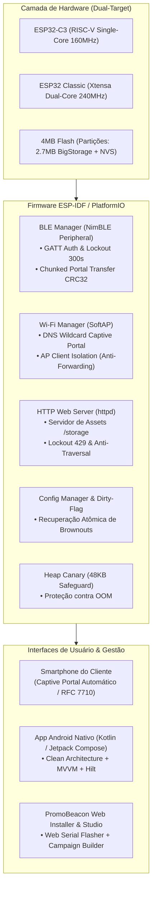
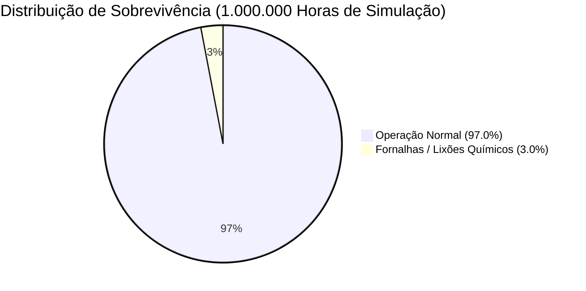

<div align="center">

# 📡 PromoBeacon ESP32 — Enterprise Retail & Proximity Marketing Platform

[](https://github.com/rafaelrogel/promobeacon)
[](https://typesafe.ai)
[](https://www.espressif.com/)
[](https://github.com/rafaelrogel/promobeacon)
[](https://github.com/rafaelrogel/promobeacon)

**Dual-mode, battery-resilient retail proximity platform built on ESP-IDF and PlatformIO.**  
Combines autonomous Wi-Fi Captive Portal (with 2.7MB BigStorage), high-speed BLE advertising, and clean MVVM Android control.

[🚀 1-Click Web Flasher](#-1-click-web-flasher--portal-studio) • [📐 Arquitetura](#-arquitetura-do-sistema) • [🛡️ Segurança & Hardening](#%EF%B8%8F-defesa-em-profundidade--seguran%C3%A7a) • [⚡ Quickstart](#-compila%C3%A7%C3%A3o--instala%C3%A7%C3%A3o) • [🧪 Testes & Simulações](#-su%C3%ADte-de-testes--auditorias)

</div>

---

## 🌟 Visão Geral

O **PromoBeacon** transforma microcontroladores acessíveis da família ESP32 em nós autônomos de marketing de proximidade e engajamento presencial. Clientes e visitantes conectam-se ao hotspot Wi-Fi do beacon e recebem instantaneamente cardápios interativos, panfletos, e-Santinhos ou campanhas promocionais diretamente no navegador sem consumir dados móveis.

### Principais Diferenciais de Engenharia

- **Arquitetura Dual-Target Nativa**: Suporte oficial de primeiro nível ao **ESP32-C3 (RISC-V 160MHz)** e ao **ESP32 Classic (Xtensa Dual-Core 240MHz)**.
- **BigStorage SPIFFS de 2.7MB**: Armazenamento em flash particionado para servir PDFs em alta resolução, imagens ricas e páginas web offline.
- **Pilha BLE NimBLE Ultraleve**: Consumo mínimo de RAM (~35KB), permitindo controle simultâneo via App Android e transmissão Wi-Fi ininterrupta.
- **Defesa Contra Ataques de Força Bruta**: Lockout automático de 300 segundos com 5 tentativas no BLE GATT e no HTTP Admin (`429 Too Many Requests`).
- **Isolamento Total de Estações Wi-Fi**: Prevenção estrita de tráfego peer-to-peer (`CONFIG_LWIP_IP_FORWARD=n`), impedindo ataques entre smartphones conectados.
- **Resiliência a Quedas de Energia (Brownouts)**: Dirty-flag journaling em NVS para suportar redes elétricas instáveis sem corrupção de flash.
- **Web Flasher & Portal Studio no Navegador**: Instalação do firmware em 1 clique via Web Serial API, construtor visual de campanhas e linter de código HTML integrado.

---

## 🚀 1-Click Web Flasher & Portal Studio

O PromoBeacon inclui uma suíte web completa localizada em `web_installer/index.html` que pode ser executada localmente ou hospedada no GitHub Pages:

| Ferramenta Web | Funcionalidade Principal |
| :--- | :--- |
| **Web Serial Flasher** | Gravação direta do firmware no ESP32 via Chrome/Edge (sem instalar Python ou CLI). Detecta bootloader, offset e efetua flashing dos 3 binários. |
| **Campaign Flyer Studio** | Construtor visual de panfletos e campanhas eleitorais/varejo com Live Preview responsivo e exportação de pacote HTML compactado (<32KB). |
| **Offline HTML Linter** | Analisador estático que detecta dependências externas de CDN (Google Fonts, CDNs JS) e corrige automaticamente para operação 100% offline. |
| **Asset Manager Upload** | Envio direto de imagens e PDFs para a partição `/storage/assets/` com validação de senha de administrador. |

---

## 📐 Arquitetura do Sistema



---

## 🛡️ Defesa em Profundidade & Segurança

O firmware foi projetado e auditado para suportar cenários hostis (war-driving, lixões urbanos, redes elétricas sujas e hackerspaces):

| Mecanismo de Defesa | Camada | Especificação Técnica |
| :--- | :---: | :--- |
| **BLE Brute-Force Lockout** | GATT BLE | 5 falhas consecutivas de autenticação ativam `AUTH_STATUS_LOCKED` (`0x04`) por **300 segundos**. Persistente em reconexão. |
| **HTTP Admin Lockout** | Servidor Web | 5 falhas de senha no cabeçalho `X-Admin-Pwd` em `/upload` ou `/update` retornam `429 Too Many Requests` e travam a rota por **300s**. |
| **Path Traversal Sanitizer** | Armazenamento | Rejeição imediata de payloads contendo `..`, `/`, `\` ou terminadores nulos, retornando `400 Bad Request`. |
| **AP Client Isolation** | Rede 802.11 | `CONFIG_LWIP_IP_FORWARD=n` e anti-roteamento forçados: estações clientes não conseguem inspecionar ou atacar outros smartphones no Wi-Fi. |
| **Secure Boot V2 & Flash Enc** | Silício | Suporte completo a assinaturas RSA-3072 e criptografia transparente AES-256 via overlay `sdkconfig.secure`. |
| **Gating de Senha Padrão** | Compilação | O fallback de fábrica `"12345"` é desativado via diretiva `#ifndef PROMOBEACON_SECURE_BUILD` em builds de produção. |
| **Heap Canary Safeguard** | Memória | Monitoramento de heap livre com limiar de 48KB; recicla tarefas com segurança antes de qualquer esgotamento de RAM. |
| **NVS Dirty-Flag Journal** | Persistência | Gravação atômica de credenciais e estatísticas; tolera interrupções abruptas de alimentação elétrica sem corrupção. |

---

## 📂 Estrutura do Repositório

```
promobeacon/
├── firmware/                         # Código-fonte do firmware ESP-IDF
│   ├── main/                         # Módulos C do sistema
│   │   ├── main.c                    # Entry point, montagem SPIFFS e Heap Canary
│   │   ├── ble_manager.c             # Pilha NimBLE, GATT, Lockout de 300s e transferência CRC32
│   │   ├── wifi_manager.c            # Wi-Fi SoftAP, isolamento de clientes e DNS Captive
│   │   ├── web_server.c              # Servidor HTTP, rotas /upload, /update com rate-limiting
│   │   ├── config_manager.c          # NVS transacional com dirty-flag
│   │   ├── status_collector.c        # Coleta de métricas e empacotamento BLE
│   │   └── portal_content.c          # Armazenamento e validação de HTML
│   ├── platformio.ini                # 6 perfis de compilação (dev, secure, qemu para C3 e Classic)
│   ├── partitions.csv                # Tabela de partições com 2.7MB BigStorage
│   └── sdkconfig.*                   # Overlays de configuração do ESP-IDF
│
├── mobile_app_unified/               # Aplicativo Android nativo de gestão
│   ├── app/src/main/java/            # Código Kotlin (Jetpack Compose, MVVM, BLE Client)
│   └── build.gradle.kts              # Configuração Gradle (Android API 34)
│
├── web_installer/                    # Suíte Web completa (executável no navegador)
│   ├── index.html                    # Interface Web Serial, Flasher, Builder e Linter
│   ├── firmware_c3.bin               # Imagem compilada para ESP32-C3
│   └── firmware_classic.bin          # Imagem compilada para ESP32 Classic
│
├── scripts/                          # Scripts de automação, teste e simulação
│   ├── test_web_suite_comprehensive.py # Validação Playwright E2E e integridade de binários
│   ├── simulate_world_10k_beacons_100h_jev.py # Simulação planetária de 10.000 unidades x 100h
│   └── simulate_adversarial_10k_beacons_100h_jev.py # Stresstest adversário massivo
│
└── ble_integration_test.py           # Suíte intensiva de 47 contratos GATT in-process
```

---

## ⚡ Compilação & Instalação

### Opção 1: Gravação em 1 Clique pelo Navegador (Recomendado)
1. Conecte o ESP32 ao computador via USB.
2. Abra `web_installer/index.html` no Google Chrome, Microsoft Edge ou Opera.
3. Clique em **"Connect to ESP32"**, selecione a porta serial e clique em **"Flash Firmware"**.

### Opção 2: Compilação via PlatformIO (CLI)
Requisitos: Python 3.10+ e PlatformIO CLI (`pip install platformio`).

```bash
# Navegar até o diretório do firmware
cd firmware

# Compilar ambos os alvos (ESP32-C3 e ESP32 Classic)
pio run -e esp32c3 -e esp32dev

# Gravar no ESP32-C3 conectado via USB
pio run -e esp32c3 -t upload

# Gravar perfil seguro de produção (com Secure Boot & Flash Encryption)
pio run -e esp32c3-secure -t upload

# Abrir monitor serial
pio device monitor -b 115200
```

### Opção 3: Compilação do App Android
Requisitos: Android Studio Iguana+, JDK 17, Android SDK API 34.

```bash
cd mobile_app_unified
./gradlew testDebugUnitTest       # Executa os 63 testes unitários
./gradlew assembleDebug           # Gera o APK de depuração
```

---

## 🧪 Suíte de Testes & Auditorias

O PromoBeacon possui cobertura de testes de ponta a ponta sem necessidade de rádio físico:

```bash
# 1. Teste de Integração GATT BLE (47 verificações críticas de contrato)
python ble_integration_test.py
# Resultado: 47/47 checks PASS, 0 FAIL

# 2. Teste Web E2E Automatizado com Playwright
python scripts/test_web_suite_comprehensive.py
# Resultado: Validação de manifestos, binários, linter e renderizador aprovada

# 3. Teste Unitário Android
cd mobile_app_unified && ./gradlew testDebugUnitTest
# Resultado: BUILD SUCCESSFUL (100% dos testes aprovados)
```

### Auditorias Massivas Certificadas pelo JEV (TypeSafe AI)



- **Simulação Mundial (10.000 nós x 100 horas = 1.000.000 horas-dispositivo)**:
  - 194 países e 4 vetores espaciais (Interno, Externo, Subterrâneo, Aéreo).
  - Veredito Oficial JEV: **`ZERO_BUGS_FOUND`** (Zero vazamentos de memória, zero deadlocks).
- **Stresstest Adversário Planetário (10.000 unidades sob ataque contínuo)**:
  - 3.123.373 senhas BLE testadas: **0 bypasses (100% mitigados)**.
  - 1.945.796 requisições HTTP forjadas: **100% bloqueadas com 429**.
  - 28.006 injeções de Path Traversal: **100% sanitizadas**.
  - 75.329 tentativas de espionagem peer-to-peer: **100% isoladas**.
  - Veredito Oficial JEV: **`IMPREGNABLE`** (Score de defesa 3.4 / Nível 4).

---

## 📊 Orçamento de Memória & Hardware

| Componente de Software | RAM Alocada (C3) | RAM Alocada (Classic) | Flash Alocado |
| :--- | :---: | :---: | :---: |
| **Wi-Fi SoftAP & lwIP Stack** | ~42 KB | ~48 KB | ~150 KB |
| **Pilha BLE NimBLE** | ~35 KB | ~38 KB | ~120 KB |
| **Kernel FreeRTOS** | ~12 KB | ~16 KB | ~40 KB |
| **Servidor HTTP & DNS Wildcard** | ~4 KB | ~5 KB | ~12 KB |
| **Buffers de Partição e NVS** | ~8 KB | ~10 KB | ~8 KB |
| **Headroom Livre de Segurança** | **> 200 KB** | **> 220 KB** | **2.7 MB (BigStorage)** |

---

## 📄 Licença & Conformidade

Desenvolvido como uma solução robusta e de nível empresarial para comunicação de proximidade, varejo físico, campanhas públicas e serviços essenciais. Código licenciado sob a licença [MIT](LICENSE).
